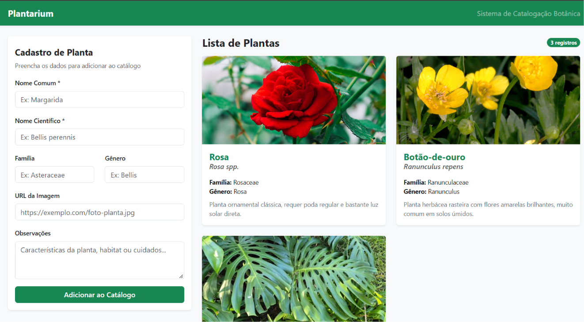
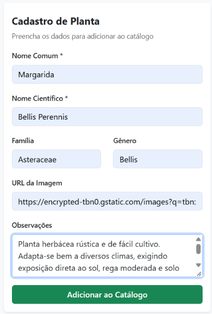
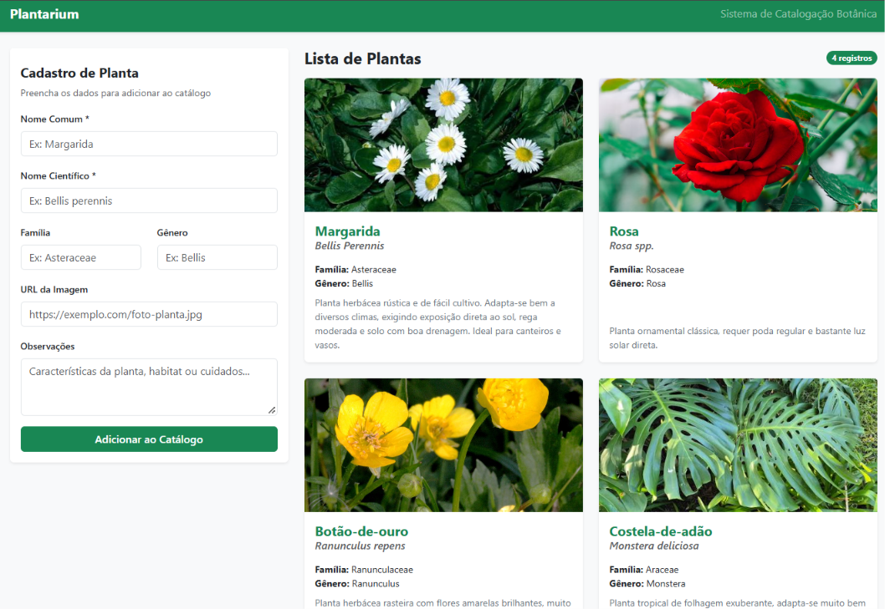

# Plantarium - Sistema de Catalogação Botânica

O projeto consiste em um catálogo botânico que permite a consulta e o registro de espécies de plantas, integrando uma interface reativa em **React** com uma API REST construída em **Node.js e Express**.

## Tecnologias Utilizadas

**Frontend**

* **React 18** (Vite) — Construído integralmente com Componentes Funcionais.

* **React Hooks** — `useState` para gerenciamento de estado da lista, controle de carregamento/erros e inputs controlados do formulário; `useEffect` para busca inicial dos dados na montagem do componente principal.

* **Fetch API** — Cliente HTTP nativo para comunicação assíncrona (`async/await`) com o backend.

* **Bootstrap 5 (via CDN)** — Estilização responsiva, sistema de grid e componentes de interface (cards, formulários, badges e spinners).

**Backend**

* **Node.js & Express** — Roteamento e construção da API REST.

* **CORS** — Middleware para liberação de requisições cross-origin entre o servidor de desenvolvimento do Vite e a API.

## Estrutura do Projeto

```
plantarium-project/
├── README.md
├── backend/
│   ├── package.json
│   └── server.js               # Servidor Express, dados iniciais e rotas /itens
└── frontend/
    ├── index.html              # Importação do Bootstrap 5 via CDN
    ├── package.json
    ├── vite.config.js
    └── src/
        ├── main.jsx            # Ponto de entrada da árvore React
        ├── App.jsx             # Gerenciamento de estado global (useState/useEffect)
        ├── services/
        │   └── itemService.js  # Isolamento das chamadas HTTP (GET e POST)
        └── components/
            ├── Navbar.jsx      # Barra de navegação superior
            ├── PlantForm.jsx   # Formulário controlado de cadastro
            ├── PlantList.jsx   # Renderização condicional e grid de plantas
            └── PlantCard.jsx   # Exibição individual de cada espécie

```

## Documentação da API REST

O servidor backend executa por padrão em `http://localhost:3001`.

### 1. Listar Plantas

* **Rota:** `GET /itens`

* **Descrição:** Retorna a lista completa de espécies botânicas armazenadas em memória.

### 2. Cadastrar Nova Planta

* **Rota:** `POST /itens`

* **Descrição:** Valida e adiciona um novo registro no início da listagem em memória. Os campos `commonName` e `scientificName` são obrigatórios; os demais assumem valores padrão caso não sejam preenchidos.

## Pré-requisitos e Instruções de Execução

Certifique-se de ter o **Node.js** (versão 18 ou superior recomendada) e o **npm** instalados em seu ambiente. A execução requer dois terminais abertos simultaneamente.

### Passo 1: Iniciar o Servidor Backend

1. No primeiro terminal, acesse o diretório do servidor:

   ```
   cd backend
   
   ```

2. Instale as dependências (`express` e `cors`):

   ```
   npm install
   
   ```

3. Inicie a API:

   ```
   npm start
   
   ```

### Passo 2: Iniciar a Aplicação Frontend

1. Em um **segundo terminal**, acesse o diretório do cliente web:

   ```
   cd frontend
   
   ```

2. Instale as dependências do React e do Vite:

   ```
   npm install
   
   ```

3. Inicie o servidor de desenvolvimento:

   ```
   npm run dev
   
   ```

## Vídeo do Projeto

[](https://drive.google.com/file/d/1WsH0lk23-DXAaCPYFa_HNHPe8ygJQf2f/view?usp=sharing)

## Capturas de Tela

* **Visão Geral (Listagem e Formulário):**


* **Cadastro de Nova Espécie:**


